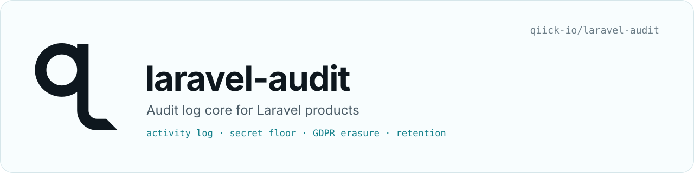

<p align="center">
  <picture>
    <source media="(prefers-color-scheme: dark)" srcset=".github/assets/header-dark.svg">
    <source media="(prefers-color-scheme: light)" srcset=".github/assets/header-light.svg">
    
  </picture>
</p>

# qiick/laravel-audit

> **In development. Not released and not on Packagist yet: do not depend on it.**

Shared audit log for qiick Laravel products, on top of
[`spatie/laravel-activitylog`](https://github.com/spatie/laravel-activitylog) v5:
the common `activity_log` table (string morph ids, `public_id`, an optional
`organisation_id`), a logging trait with a secret floor, server-side
attribution (who acted, through which credential), a GDPR anonymisation
contract and a two-floor retention purge. Product audit tables stay in the
products.

Part of the qiick fleet. Binding design:
`projects/qiick/packages/laravel-audit-design.md` in the knowledge base
(decisions: `decisions/2026-11-23-pre-1-0-extractions.md`).

## Status

Pre-release: `0.1.0-beta.1`. Public APIs may change in any 0.x release; see [UPGRADING.md](./UPGRADING.md).
Do not require this package from production apps until a tagged release lands on
Packagist (Packagist publish only after Luca’s go).

## Requirements

- PHP `^8.4`. `spatie/laravel-activitylog` v5, which the design and every
  product build on, requires PHP 8.4, so the package cannot support 8.3.
- Illuminate console / contracts / database / http / support `^12.0 || ^13.0`
  (never `laravel/framework`)
- `spatie/laravel-activitylog` `^5.1.3`: earlier 5.x releases write `causer_id`
  by name in the logger (`causedByAnonymous()`, the default causer), which
  `audit.columns` cannot follow
- Optional: `qiick/laravel-access`, which fills `actor_kind` from its actor
  context.

## Install (when published)

```bash
composer require qiick/laravel-audit:^0.1@beta
php artisan vendor:publish --tag=audit-config
```

## Configuration

| Key | Default | Meaning |
| --- | --- | --- |
| `audit.sensitive_attributes` | `password`, `remember_token`, `two_factor_secret`, `two_factor_recovery_codes`, `key_hash`, `previous_key_hash`, `secret`, `token_hash`, `private_key` | logged as `[redacted]`, on top of the built-in names and parts and `encrypted*` / `hashed` casts |
| `audit.sensitive_parts` | `[]` | extra name parts that make a value secret (other languages) |
| `audit.personal_keys` | `[]` | extra property keys the anonymiser scrubs |
| `audit.user_agent_max` | `512` | stored user agent length |
| `audit.retention_days` | `365` | general retention floor |
| `audit.security_log_names` | `auth`, `security`, `access`, `api-keys` | the security logs, kept longer |
| `audit.security_retention_days` | `730` | security logs retention floor |
| `audit.purge.schedule` | `true` | the provider schedules the purge daily |
| `audit.purge.time` | `03:00` | when the scheduled purge runs, UTC |
| `audit.purge.chunk_size` | `1000` | rows deleted per statement |
| `audit.migrations.load` | `true` | load the package's `activity_log` migration |
| `audit.columns` | `subject_id` / `causer_id` | morph id columns (externa 1.x only changes them) |

## Schema

The package owns the `activity_log` migration (Spatie's table name and
columns, so Spatie keeps working):

| Column | Type | Notes |
| --- | --- | --- |
| `id` | bigint | internal, never leaves the database |
| `public_id` | uuid, unique | UUID v7, generated by the model; the id resources and exports use |
| `log_name`, `event` | string; `event` indexed, `log_name` indexed with `created_at` | Spatie |
| `description` | text | Spatie |
| `subject_type` / `subject_id`, `causer_type` / `causer_id` | string / `string(64)` | morphs for bigint, UUID and ULID keys; indexes `subject`, `causer` |
| `organisation_id` | uuid, nullable, indexed with `created_at` | tenant perimeter |
| `attribute_changes`, `properties` | json | Spatie v5 |
| `schema_version` | unsigned small int, default `1` | row format: `1` current, `0` legacy externa row |
| `request_id` | `string(128)`, indexed | correlation with application logs (http-basics accepts up to 128 characters) |
| `anonymised_at` | datetime | set by the anonymiser |
| `created_at`, `updated_at` | datetime (never MySQL `TIMESTAMP`, which ends in 2038); `created_at` NOT NULL, indexed | UTC |

There are no foreign keys: activity morphs never cascade, and audit rows are
anonymised, never deleted on erasure. In production the migration's `down()`
refuses to drop a table that has rows; `migrate:fresh` and `db:wipe` drop
tables without `down()`, so never run them against a production database. The package sets
`activitylog.activity_model` to `Qiick\Audit\Models\Activity` and
`activitylog.actions.log_activity` to `Qiick\Audit\Actions\LogActivityAction`
unless the product configured subclasses of its own.

## Logging trait

```php
use Qiick\Audit\Concerns\LogsActivity;

final class Project extends Model
{
    use LogsActivity;

    // Optional: a log name or extra excludes. The secret floor still applies.
    public function getActivitylogOptions(): LogOptions
    {
        return $this->auditActivityLogOptions()->useLogName('projects')->logExcept(['notes']);
    }
}
```

The trait never logs a secret value, but it logs that a secret changed: the
value becomes `[redacted]` and the key stays, so "the password changed" is in
the log. A value is secret when the model casts it as `encrypted*` or
`hashed`, when its name (in any spelling: `privateKey`, `remember-token`,
`X-Api-Key`) is on the floor (the built-in names, `audit.sensitive_attributes`),
or when its name contains a secret part: `password`, `secret`, `token`,
`private_key`, `api_key`, `two_factor`, `recovery_code`, `remember`,
`passphrase`, `passwd`, `credential`, `authorization`, `cookie`, `session`,
`segreto`, plus `audit.sensitive_parts` (for names in other languages). A
name with a secret part is not redacted when the name ends in `_at` / `_on`
or the cast is a date, a boolean or an integer: `two_factor_confirmed_at`
records who turned two-factor on, and its value is a time. Short
abbreviations (`pwd`, `pass`, `otp`, `pin`, `cvv`, `iban`, `dsn`) are exact
names only.

This holds by name, by JSON path (`settings->secret`), through a relation
(`owner.password`) and at any depth inside a logged JSON value. A relation
logged by name (`owner`, `owner.owner`) and any value that holds a model are
not logged at all. Description placeholders read only attributes and
relations already loaded on the model, never call a model method, and stay as
written for a secret or a non-scalar value.

The floor works on names. An accessor that the model logs is the model's
responsibility: one that returns a related model's `toArray()` or a secret
under an ordinary name is logged as it returns it.

Audit rows are written once: the model refuses to update or delete a stored
row, with or without model events (`saveQuietly()`, `deleteQuietly()`,
`Model::withoutEvents()`), and the package columns are not mass-assignable,
even inside `Model::unguarded()`. This guards against
mistakes, not against product code: `Activity::query()->update()` and
`->delete()` go through the query builder, which the anonymiser and the purge
use, and the model cannot stop them. Never write to `activity_log` that way.

### Trust boundary

The package protects the log against mistakes in application code, not
against code that sets out to change it. Inside the package, a test allows
query-builder writes to `activity_log` only in the anonymiser and the
retention purge. The strong guarantee is the database: give the web and
queue processes a role that can `INSERT` and `SELECT` on `activity_log` but
not `UPDATE` or `DELETE`, and run `audit:purge` and the erasure job with a
role that can. Each row's `public_id` and timestamps make tampering visible
only to someone who compares copies; hash chaining is after 1.0 (design §3).

For models that cause activity, use `Qiick\Audit\Concerns\CausesActivity`
(or `HasActivity` for both): their `activitiesAsCauser()` / `activities()`
relations work on PostgreSQL for bigint keys and follow `audit.columns`.
Never use Spatie's `HasActivity`: it brings Spatie's `LogsActivity` without
the secret floor.

## Attribution

Every row the package logs carries server-side attribution, written after
every `beforeLogging` callback, so a caller can never forge it:

| `properties` key | Value |
| --- | --- |
| `ip`, `user_agent` | the routed HTTP request (user agent cut to `audit.user_agent_max`); absent in console commands and jobs |
| `actor_kind` | `web_session`, `api_key`, `oauth_grant`, `public_api` or `unattended` |
| `api_key_id`, `api_key_prefix`, `api_key_created_by` | the bound API key: public UUID, display prefix, creator's public id |
| `oauth_client_id` | the bound OAuth grant's client UUID |

A caller's value for any of these keys is removed.

The causer: when a credential acts, its owner principal replaces any causer
the caller chose. Otherwise the caller's choice stands: an explicit
`causedBy($admin)` (an admin stopping an impersonation) or
`causedByAnonymous()` is kept, and the signed-in user is the causer when none
was chosen. Description placeholders are resolved before this rule, so under
a credential `:causer.name` names the caller's causer, not the owner.

The key or OAuth middleware
binds the credential once it is verified:

```php
use Qiick\Audit\AuditContext;
use Qiick\Audit\Contracts\AuditActor;

AuditContext::bindCredential(new AuditActor(
    causer: $apiKey->ownerPrincipal,   // the credential's owner is the causer
    actorKind: 'api_key',
    apiKeyId: $apiKey->public_id,      // UUID, never the bigint
    apiKeyPrefix: $apiKey->prefix,
    apiKeyCreatedBy: $apiKey->creator->public_id,
));
```

Products that wrote `api_key_id` through `Qiick\ApiKeys\Audit::withApiKeyId()`
bind the credential instead: the reserved key is the server's.

The organisation goes in the `organisation_id` column, never in
`properties`: either explicitly,
`activity()->tap(Audit::inOrganisation($organisationUuid))->log(...)`, or from
the product's `OrganisationResolver` binding (default: none). `request_id`
comes from the `request_id` key of Laravel's context, which
`qiick/laravel-http-basics` sets.

## Transactions

- **A logged row joins the ambient transaction**, as Spatie's does: the row is
  written with the business change it describes, and it rolls back with it.
  The log never says that a change happened when it did not. This coupling
  holds only on one connection: the activity model's connection (by default
  the application's default connection) must be the one the business write
  uses. A transaction on another connection commits and rolls back on its
  own.
- **Evidence of an attempt that fails** (a rejected privilege change, a
  refused delete) is therefore lost if it is logged inside the transaction
  that rolls back. Log such attempts outside it: before `DB::transaction()`
  starts, or in the failure path after it has rolled back
  (`catch (Throwable $exception) { activity('security')->...->log(...); throw $exception; }`).
- **Buffered logging** (`activitylog.buffer.enabled`), which writes after the
  response, is refused in production by a boot check: buffered security
  events are lost when the process dies.
- **Erasure joins the caller's transaction too**, as a savepoint on the
  activity model's connection, and `ActivityAnonymised` is dispatched only
  after the outermost commit **of that connection**: when the product's
  erasure transaction rolls back, the anonymisation is undone and no listener
  hears of it, whatever other connections commit meanwhile. Run the erasure
  job's tombstoning on the same connection, or the two do not roll back
  together.
- **Concurrent erasures** lock the rows they read (`SELECT … FOR UPDATE` on
  PostgreSQL, MySQL and MariaDB), so two erasures of people who share a row
  (one causer, the other subject) run one after the other on that row and
  neither writes back a name the other scrubbed.
- **The retention purge** deletes in chunks, each its own statement, without
  a transaction of its own: a run that stops halfway leaves only rows that
  the next run deletes.

## Erasure (GDPR)

The product's erasure job calls the anonymiser in the same transaction as the
user tombstoning, or after it, never alone:

```php
use Qiick\Audit\Contracts\AuditAnonymiser;
use Qiick\Audit\Contracts\ErasureSubject;
use Qiick\Audit\Contracts\MorphRef;

$report = app(AuditAnonymiser::class)->anonymise(new ErasureSubject(
    refs: [MorphRef::of($user), MorphRef::of($principal)],  // every model that identifies the person
    tombstone: $user->tombstone,                             // the product's unique tombstone
    identifiers: [$email, $username, $displayName],          // scrubbed from free text
));
```

Matching rows keep their event, log name, timestamps and morphs; their
personal keys, the identifiers (as whole words) and any email address or
phone-like sequence become the tombstone, and `anonymised_at` is set. A second
run reports `0` rows. The tombstone must not contain an identifier or look
like an email address or a phone number.

The fleet-standard `AuditEraser` (one `erase()` shape for every qiick package)
arrives before 1.0, once the fleet conformance suite is merged; until then the
anonymiser is the entry point (`docs/decisions/2026-11-25-standard-eraser-after-conformance.md`).

### Erasure perimeter and caller duties

The anonymiser erases what it can recognise, and no more. Calling it is one
step of an Art. 17 erasure, not the whole of it.

**What it covers**

- Rows where one of the `refs` is the **causer or the subject**, matched by
  stored morph type and id (`audit.columns` honoured). Pass every model that
  identifies the person: user, principals, API keys. Rows written before the
  product set a morph map store the class name: pass both refs (UPGRADING).
- In those rows: the personal keys at any depth of `properties` and
  `attribute_changes`, in any spelling (`ip`, `ip_address`, `user_agent`,
  `email`, `username`, `name`, `first_name`, `last_name`, plus
  `audit.personal_keys`); every `identifiers` value as a whole word; every
  email address and phone-like sequence (8–15 digits) in any string and in
  `description`.

**What it does not cover**

- **Other people's rows.** A row caused by an admin about another subject that
  mentions the person in free text (`description` or a property) is outside
  the perimeter: only causer and subject are matched.
- **Free text the patterns do not recognise.** A postal address, a date of
  birth, a nickname not in `identifiers`, or a phone number stored as a JSON
  number survives unless its key is a personal key.
- **Unlisted property keys.** A personal value under a key that is not a
  personal key and is not email- or phone-shaped stays.
- **Rows written after the run** (the anonymiser is one pass over the rows it
  finds); run it after the account is deactivated, and run it again if needed:
  it is idempotent.
- Application logs, queues and backups.

**What the product must do**

1. Keep personal data out of `description`: put it in properties under keys
   the anonymiser knows, or add the product's keys to `audit.personal_keys`.
2. Pass every `refs` and every `identifiers` value the person is known by.
3. Deactivate the account first, then anonymise, so no new row about the
   person is written during the erasure.
4. Erase or anonymise the product's own tables, logs and backups.

## Retention

Every log is kept 365 days, and the security logs 730 days: `auth`,
`security`, `access` and `api-keys` by default (`audit.security_log_names`),
because security events are kept two years. Log names are stored trimmed and
in lower case, so `Auth` and `auth` are one log on every engine.
`php artisan audit:purge` deletes in two passes on `created_at`: rows outside
the security logs past `audit.retention_days`, then security log rows past
`audit.security_retention_days`. The provider schedules it daily at
`audit.purge.time` (UTC), on one server and without overlapping itself,
through the scheduler's cache lock: every scheduler host must use the same
cache store, with locks and the same prefix, and the overlap lock lasts 24
hours, so a run still going after a day can meet the next one. A product
that runs it itself sets `audit.purge.schedule` to `false`. Overlapping runs
are safe anyway: the ids to delete are read from the write connection (never
a replica that may lag) and each delete rechecks the cutoff.

Spatie's `activitylog:clean` goes through the same two floors: the package
sets `activitylog.actions.clean_log` to its own clean action, so
`activitylog:clean --days=1` (or a named log) never deletes a row younger than
365 days, or a security log row younger than 730. A product that keeps it in the
schedule loses nothing; `audit:purge` alone is enough.

## Querying

`Activity::query()->causedBy($user)`, `->forSubject($model)` and
`->forOrganisation($organisationUuid)` bind ids as strings. `forOrganisation`
never returns rows without an organisation: those are for the instance
super-admin, through an unscoped query the product guards. `causedBy`,
`forSubject` and `activitiesAsSubject()` do not filter by organisation: a
tenant page always adds `forOrganisation()`.

## Boot checks

The application does not boot when:

- `activitylog.activity_model` does not extend `Qiick\Audit\Models\Activity`,
  `activitylog.actions.log_activity` does not extend
  `Qiick\Audit\Actions\LogActivityAction` (it writes the attribution), or
  `activitylog.actions.clean_log` does not extend
  `Qiick\Audit\Actions\CleanActivityLogAction` (it applies the retention
  floors);
- `app.timezone` is not `UTC`;
- in production, `activitylog.enabled` is not `true` or
  `activitylog.buffer.enabled` is not `false` (security events must not be
  turned off or lost by one env variable).

Serialised rows never carry the bigint `id`; timestamps are RFC 3339 UTC.
The security checklist maps every design risk to its tests:
[docs/security-checklist.md](./docs/security-checklist.md). Adopting the
package in a product: [UPGRADING.md](./UPGRADING.md).

## Deprecation policy

This package follows [Semantic Versioning](https://semver.org/spec/v2.0.0.html) (SemVer):

- **Deprecation in minor releases:** When a public API (class, method, interface, config key,
  or environment variable) is deprecated, it is marked with `@deprecated` docblocks, documented
  in `CHANGELOG.md` and `UPGRADING.md`, and triggers a runtime notice or warning where appropriate.
  The deprecated feature remains functional and supported for at least one minor release.
- **Removal in major releases only:** Deprecated APIs are never removed within the same major
  version (`0.x` or `1.x`). Breaking removals occur exclusively at the next major release
  boundary (e.g. `2.0.0`).
- **Pre-1.0 stability:** In `0.x`, breaking changes are documented in `UPGRADING.md` before
  each tagged release. Once `1.0.0` ships, public contracts and migrations are frozen and
  follow strict SemVer forward compatibility.

## Security

Private vulnerability reporting: see [SECURITY.md](./SECURITY.md).

## License

MIT. See [LICENSE](./LICENSE).
